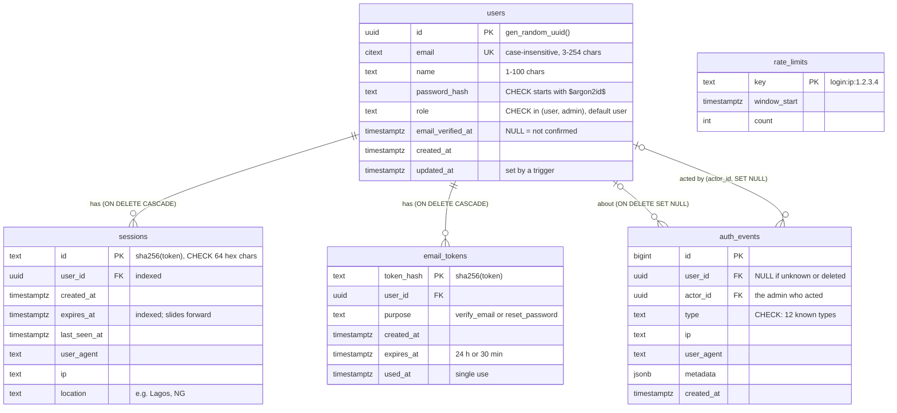
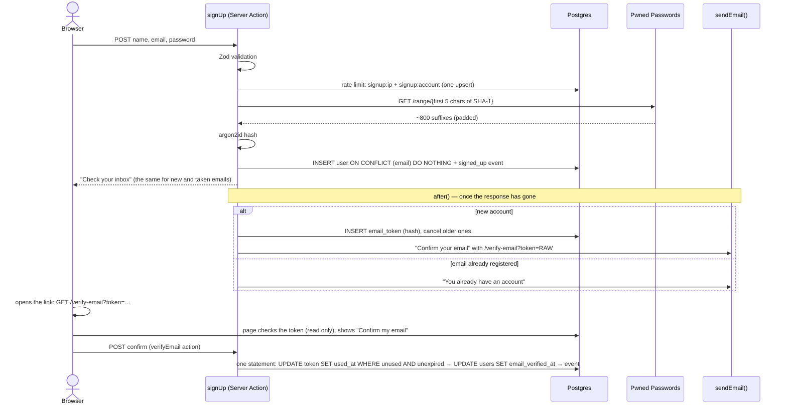
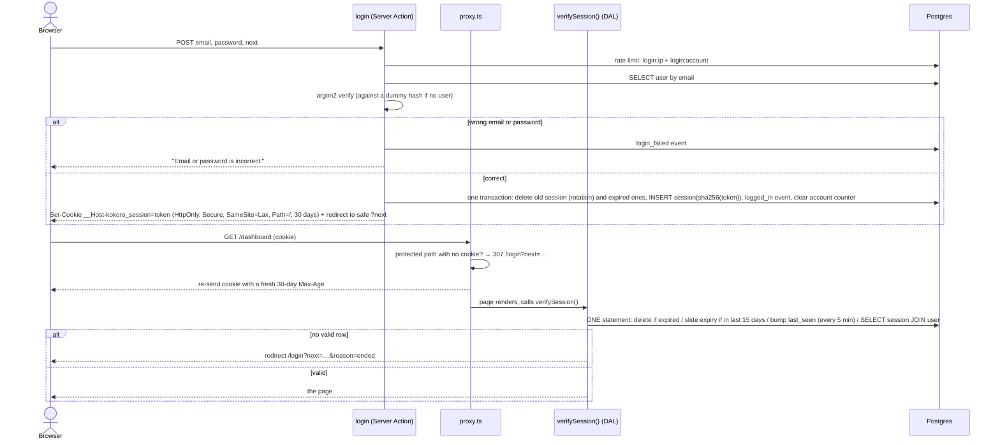
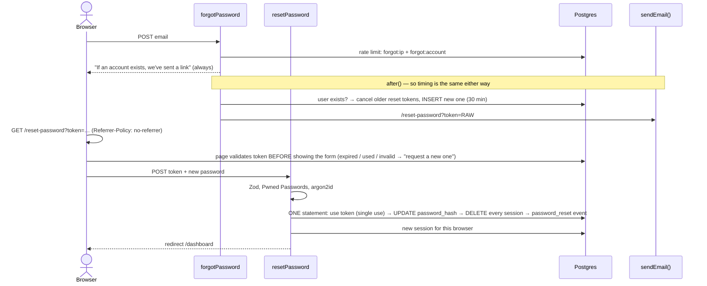

# Kọ́kọ́rọ́ — accounts and sessions, built by hand

**Kọ́kọ́rọ́** means "key" in Yoruba. It's Day 17 of a 30-day build challenge: a complete authentication system written **without any auth library**, so every part a library like Auth.js or Better Auth would hide is out in the open.

- Sign up, with email verification behind a confirm button
- Sign in with database sessions: a random token in an httpOnly cookie, only its SHA-256 hash stored, 30-day sliding expiry, rotation at every sign-in
- Forgot and reset password with single-use, 30-minute links
- Rate limiting by IP and by account, stored in PostgreSQL
- Breached-password check against Have I Been Pwned using k-anonymity
- No account enumeration: the same answers, in the same time, whether or not an account exists
- `/account`: change your name or password, or delete your account
- `/account/sessions`: every signed-in device, with revoke and "sign out everywhere else"
- `/account/activity`: your own audit log
- `/admin` (admins only): search users, promote or demote them, sign them out everywhere, with every action logged

**Stack:** Next.js 16.4 (App Router, Cache Components, `proxy.ts`), TypeScript (strict, `noUncheckedIndexedAccess`), Tailwind CSS v4, PostgreSQL on Neon via `@neondatabase/serverless` with plain parameterised SQL, Zod 4, `@node-rs/argon2`. Email goes through Resend's HTTP API if you have a key, or is printed to the console if you don't.

---

## Contents

1. [Run it locally](#run-it-locally)
2. [Deploy to Vercel](#deploy-to-vercel)
3. [The database](#the-database)
4. [The flows](#the-flows)
5. [How the security works](#how-the-security-works)
6. [EXPLAIN: the session lookup](#explain-the-session-lookup)
7. [Design](#design)
8. [Security checklist](#security-checklist)
9. [How to reuse this auth on another day](#how-to-reuse-this-auth-on-another-day)
10. [Concepts and where they live](#concepts-and-where-they-live)
11. [Not built (yet)](#not-built-yet)

---

## Run it locally

You need Node 22.18 or newer: the scripts in `scripts/` are TypeScript that Node runs directly.

```bash
npm install
cp .env.example .env.local     # then fill it in (below)
npm run db:migrate             # creates the tables; safe to run again
npm run db:seed                # admin@example.com + user@example.com; safe to run again
npm run dev                    # http://localhost:3000
```

**Neon:** create a project at [neon.tech](https://neon.tech), open **Connect**, turn **Connection pooling** on, and paste that connection string (its host contains `-pooler`) into `DATABASE_URL`. The pooled string matters on serverless hosts: many short-lived functions share a handful of real PostgreSQL connections. Optionally, add the direct (unpooled) string as `DATABASE_URL_UNPOOLED`; `db:migrate` prefers it.

**Email:** leave `RESEND_API_KEY` empty and every email (verification, reset, "you already have an account") is printed to the terminal running `npm run dev`, link included. Copy the link into the browser. To send real email, create a key at [resend.com](https://resend.com) and set `EMAIL_FROM`: `onboarding@resend.dev` works for testing (it only delivers to your own address), and for anyone else you'll need a domain you've verified in Resend.

**Demo accounts:** set `SEED_ADMIN_PASSWORD` and `SEED_USER_PASSWORD` (8 to 128 characters each) before `npm run db:seed`. The passwords live only in your environment, never in the code.

| Script | What it does |
| --- | --- |
| `npm run db:migrate` | Applies new files from `db/migrations/` in order, each in its own transaction, recorded in `schema_migrations` |
| `npm run db:seed` | Creates the two demo accounts (`ON CONFLICT DO NOTHING`, so running it twice changes nothing) |
| `npm run db:explain` | Prints `EXPLAIN ANALYZE` for the hot queries, before and after adding 50,000 sessions in a rolled-back transaction |
| `npm run db:cleanup` | Deletes expired sessions, old email tokens, stale rate-limit counters and audit events older than a year |
| `npm run check:contrast` | Checks every colour pair the UI uses against WCAG AA, in both themes |
| `npm run typecheck` | `next typegen && tsc --noEmit` |

## Deploy to Vercel

1. Push the repo to GitHub and import it in Vercel. The defaults (framework Next.js, `npm run build`) are right.
2. Add the environment variables below (Project → Settings → Environment Variables).
3. Run `npm run db:migrate` and `npm run db:seed` once from your machine against the same database (or use Neon's Vercel integration, which sets `DATABASE_URL` for you).

| Variable | Needed on Vercel? | Value |
| --- | --- | --- |
| `DATABASE_URL` | Yes | Neon **pooled** connection string |
| `APP_URL` | Yes | Your public address, e.g. `https://kokoro.vercel.app` (no trailing slash). Every email link is built from it. |
| `RESEND_API_KEY` | Optional | Without it, emails only appear in Vercel's function logs |
| `EMAIL_FROM` | With Resend | e.g. `Kọ́kọ́rọ́ <auth@your-domain.com>` |
| `DATABASE_URL_UNPOOLED` | No | Only used by `db:migrate` on your machine |
| `SEED_ADMIN_PASSWORD`, `SEED_USER_PASSWORD` | No | Only used by `db:seed` on your machine |

`@node-rs/argon2` is a native module with prebuilt binaries for every platform. It's in Next.js's built-in `serverExternalPackages` list, and `package-lock.json` includes the `linux-x64-gnu` binary that Vercel's Node runtime uses, so no configuration is needed. Emails are sent with `after()`, which Vercel keeps alive (via `waitUntil`) after the response has gone.

---

## The database

Plain SQL in numbered migrations (`db/migrations/001_users.sql` … `005_rate_limits.sql`). Every table, column, constraint and index has a comment in its migration saying why it exists.



| Table | Why it exists | Key decisions |
| --- | --- | --- |
| `users` | One row per account | `citext` email so `Ada@X.com` and `ada@x.com` are the same account; `UNIQUE` is both the login index and the guarantee against duplicate sign-ups racing each other; the role is a `CHECK`, not a table, because there are exactly two |
| `sessions` | One row per signed-in browser | The primary key is the **hash** of the cookie's token; `user_id` is indexed for "list my sessions" and "sign out everywhere"; `expires_at` is indexed for cleanup; `CASCADE` so a deleted user is signed out everywhere |
| `email_tokens` | Verification and reset links | Hashed like sessions; `purpose` stops a verify token from being used as a reset token; `used_at` makes them single-use; `(user_id, purpose)` is indexed so a new link cancels older ones |
| `auth_events` | The audit log | Insert-only; `SET NULL` on delete keeps an anonymised history; `(user_id, created_at DESC)` serves both the activity page and the admin list's "last sign-in" |
| `rate_limits` | Attempt counters | One row per key and window, changed with one atomic upsert |

## The flows

### Sign up → verify email



### Login → session cookie → each request



### Password reset



---

## How the security works

### Hash, not encrypt, and why argon2id ([`lib/auth/password.ts`](lib/auth/password.ts))

**Encryption is two-way.** Whoever has the key can decrypt every password, and the key must sit on the server to check logins. Steal the database and the server's environment, and you have every password in plain text, ready to try on people's email and bank accounts.

**A hash is one-way.** We never need the password back. To check a login, we hash what was typed and compare the two hashes. A stolen table can only be attacked by guessing.

**A salt** is 16 random bytes mixed into each password before hashing, and stored inside the result. Two people who both chose `lagos123` get unrelated hashes. So an attacker can't hash a dictionary once and look everyone up in it (a "rainbow table"), and can't see who shares a password.

**The cost settings** make each guess expensive. SHA-256 runs billions of times a second on a gaming GPU. argon2id needs `memoryCost` (19 MiB) of RAM per guess, which is exactly what GPUs lack. We pay about 50 ms once per login; an attacker pays that for every one of billions of guesses. These are OWASP's recommended minimums (`m=19456, t=2, p=1`). They are stored in each hash (`$argon2id$v=19$m=19456,t=2,p=1$…`), so they can be raised later; `needsRehash()` upgrades old hashes at the next login.

### Sessions in the database, with only a hash stored ([`lib/auth/session.ts`](lib/auth/session.ts))

The cookie holds **32 random bytes** from `crypto.randomBytes`, as 43 base64url characters. The `sessions` table holds **SHA-256(token)**. If the table leaks (a backup, a log, a read-only SQL injection), the attacker has hashes that can't be turned back into a working cookie. A fast hash is fine here, unlike for passwords: a 256-bit random token has nothing to guess.

Unlike a JWT, a database session can be ended at any moment, by deleting its row. Sign out, "sign out everywhere else", an admin revoking a user, a password reset: each takes effect on the very next request.

**The cookie's flags** ([`lib/auth/cookie.ts`](lib/auth/cookie.ts)):

| Flag | What it stops |
| --- | --- |
| `HttpOnly` | Page JavaScript can't read the cookie, so an XSS bug can't copy the token to another machine |
| `Secure` (production) | Only sent over HTTPS, so it can't be read on the café Wi-Fi |
| `SameSite=Lax` | Not sent on other sites' background requests (hidden form posts, images, fetch), but still sent when you click a link to us. Blocks most CSRF; `Strict` would make every arrival from an email look signed out |
| `Path=/` | Sent with every page, not just one folder |
| `__Host-` name prefix (production) | The browser only accepts it if it's `Secure`, has `Path=/` and has no `Domain`, so no subdomain or other site can plant or overwrite it |

**Sliding renewal:** a session lasts 30 days. If it's used in its last 15 days, its expiry moves back out to 30 days from now. That happens in the same single SQL statement that reads the session, and at most once per request, because `verifySession()` is memoised with React's `cache()`. Expired sessions are rejected, and deleted as soon as their cookie is seen. Pages can't set cookies while rendering, so `proxy.ts` re-sends the cookie with a fresh `Max-Age` on each page load; the database decides when the session really ends.

**Rotation:** signing in always deletes the browser's old session and makes a new token. That defeats session fixation, where an attacker plants a known cookie value before you sign in. Changing your password also gives the current browser a fresh token and signs out every other session. A reset signs out every session.

### Why the proxy alone must never be trusted ([`proxy.ts`](proxy.ts), [`lib/auth/dal.ts`](lib/auth/dal.ts))

`proxy.ts` runs before every page, but only checks that a cookie **exists**. It doesn't ask the database: it runs on every request, including prefetches, and it can't afford a database trip each time. An expired, revoked or made-up cookie passes that check. On top of that:

- **Server Actions are POST requests to a page's URL.** A matcher mistake can silently skip one.
- **A route can be reached in more ways than you think.** Rewrites, new routes added later, or a `matcher` regex that misses a case.
- **Layouts don't re-render on navigation**, so a check in a layout alone doesn't protect the pages under it.

So the proxy only gives a fast, friendly redirect. The real decision is `verifySession()` / `requireRole()` in the data access layer, called at the top of every protected page, Server Action and route handler, right next to the data. The proxy also never redirects `/login` to `/dashboard`: with a stale cookie, that and "dashboard → login" would bounce forever.

We also deliberately don't use `'use cache: private'` for the session read, although the Next.js docs suggest it. It keeps the result in the browser for up to 5 minutes, so a session revoked from another device would keep working here for those minutes.

### CSRF

- **Server Actions:** Next.js only lets them run on `POST`, and compares the request's `Origin` header with `Host` (or `X-Forwarded-Host`), aborting on a mismatch. Together with `SameSite=Lax`, a form on another site can't call them. Tested: replaying the forgot-password action with `Origin: https://evil.example` is refused ("`x-forwarded-host` … does not match `origin` … Aborting the action").
- **Route handlers get none of that.** [`app/logout/route.ts`](app/logout/route.ts) exports only `POST` (a `GET` gets 405, so an `` can't sign you out), and calls `isSameOrigin()` from [`lib/auth/request.ts`](lib/auth/request.ts), which refuses a missing or foreign `Origin` with 403.

### No account enumeration ([`app/(auth)/actions.ts`](<app/(auth)/actions.ts>))

If a site says "no account with that email", anyone can test which addresses are registered. That's useful for phishing, and embarrassing on a sensitive site. So:

- **Login** says "Email or password is incorrect." either way, and runs argon2 against a dummy hash when there's no user, so both cases take about 50 ms.
- **Forgot password** always says "If an account exists, we've sent a link". Finding the user, making the token and sending the email all happen in `after()`, once the response has gone, so the timing is the same too. Measured: 424 ms for a real address, 513 ms for an unknown one (both are mostly network round trips).
- **Sign up** shows the same "check your inbox" screen for new and taken addresses. Only the inbox's owner learns the difference: they get a "you already have an account" email instead. That's also why sign-up doesn't sign you straight in; you sign in next (unverified accounts can).

### Rate limiting, not lockout ([`lib/auth/rate-limit.ts`](lib/auth/rate-limit.ts))

| Action | Per IP | Per account | Window |
| --- | --- | --- | --- |
| Login (and "current password" checks) | 20 | 5 | 15 minutes |
| Sign up | 5 | 3 | 1 hour |
| Forgot password | 10 | 3 | 1 hour |
| Resend verification | 10 | 3 (per user) | 1 hour |

Per IP stops one machine guessing many accounts; per account stops a botnet guessing one. Attempts are counted **before** the password is checked, so a blocked attempt never reaches argon2. A successful password check clears that account's counter. The account part of each key is a SHA-256 prefix of the email, so the table isn't a list of addresses.

**Why not lock the account after N failures?** Because then anyone can lock *you* out, just by typing your email with wrong passwords. A rate limit only slows guessing down (millions of tries become a few hundred a day). The real owner gets back in when the window passes, or immediately with a reset link.

**Why Postgres and not memory?** On Vercel, each request may run in a different short-lived instance. A counter in one instance's memory is invisible to the others and vanishes when it sleeps, so spreading guesses across instances would never hit the limit. One `INSERT … ON CONFLICT DO UPDATE … RETURNING` counts both keys atomically: two simultaneous requests can't both be "the 5th".

### Breached passwords and k-anonymity ([`lib/auth/password.ts`](lib/auth/password.ts))

Billions of real passwords have leaked from other sites, and attackers try those first. We check new passwords against Have I Been Pwned's Pwned Passwords API **without sending the password, or even its full hash**:

1. SHA-1 the password: `P@ssw0rd` → `21BD12DC183F740EE76F27B78EB39C8AD972A757`
2. Send only the first 5 characters: `GET https://api.pwnedpasswords.com/range/21BD1`
3. The API returns every leaked hash suffix starting with `21BD1` (hundreds), and we look for ours **on our server**.

The service only learns "someone checked a password whose hash starts with 21BD1", which hundreds of thousands of passwords share. That's **k-anonymity**: our request is indistinguishable from k others. `Add-Padding: true` adds decoy entries so even the response size reveals nothing. If the API is down or slow (2.5 s timeout), the password is allowed and a warning is logged; refusing every sign-up because a third party is down would be worse.

### Safe redirects ([`lib/safe-redirect.ts`](lib/safe-redirect.ts))

`/login?next=…` only accepts a path on this site. `//evil.example`, `/\evil.example`, `https://evil.example` and anything that resolves to another origin fall back to `/dashboard`. Without this, a phishing email could send you to the real login page and bounce you to a lookalike afterwards.

### Unverified accounts

They can sign in, but see a banner ("Please confirm your email address", with a "Send a new link" button). `requireRole('admin')` also requires a confirmed email, so an unconfirmed admin can't open `/admin`. Changing your email address isn't built yet; the account page shows it read-only.

---

## EXPLAIN: the session lookup

`npm run db:explain` runs the exact statement `readSession()` sends on every request. Here it is with 5,000 users, 50,000 sessions and 100,000 events added inside a transaction that's rolled back afterwards:

```
-- Session lookup on every request (readSession)
Nested Loop Left Join (actual time=0.029..0.030 rows=1.00 loops=1)
  Buffers: shared hit=11
  CTE expired
    ->  Delete on sessions (actual time=0.002..0.002 rows=0.00 loops=1)
          ->  Index Scan using sessions_pkey on sessions (actual time=0.002..0.002 rows=0.00 loops=1)
                Index Cond: (id = '3f8c0f7a…8076'::text)
                Filter: (expires_at <= now())
                Rows Removed by Filter: 1
  CTE touched
    ->  Update on sessions sessions_1 (actual time=0.004..0.004 rows=0.00 loops=1)
          ->  Index Scan using sessions_pkey on sessions sessions_1 (actual time=0.003..0.003 rows=0.00 loops=1)
                Index Cond: (id = '3f8c0f7a…8076'::text)
                Filter: ((expires_at > now()) AND ((last_seen_at < (now() - '00:05:00'::interval)) OR (expires_at < (now() + '360:00:00'::interval))))
                Rows Removed by Filter: 1
  ->  Nested Loop (actual time=0.023..0.023 rows=1.00 loops=1)
        ->  Index Scan using sessions_pkey on sessions s (actual time=0.018..0.019 rows=1.00 loops=1)
              Index Cond: (id = '3f8c0f7a…8076'::text)
              Filter: (expires_at > now())
        ->  Index Scan using users_pkey on users u (actual time=0.003..0.003 rows=1.00 loops=1)
              Index Cond: (id = s.user_id)
  ->  CTE Scan on touched t (actual time=0.005..0.005 rows=0.00 loops=1)
Planning Time: 0.451 ms
Execution Time: 0.075 ms
```

How to read it:

- **Every step is an `Index Scan using sessions_pkey`**: one probe into the primary-key index, whether the table has 6 rows or 50,000. The join to `users` is one more probe into `users_pkey`.
- **`expired` and `touched` matched nothing.** This session was neither expired nor in its last 15 days, and was seen under 5 minutes ago, so the request wrote nothing.
- **0.075 ms on the server.** Almost all of a request's wait is the network round trip to the database (about 250 ms from Lagos to Frankfurt), which is why the whole check is ONE statement, not three.

The same script shows the login lookup using `users_email_key` (the citext `UNIQUE` index, matching `ADA@EXAMPLE.COM` case-insensitively), the sessions list using `sessions_user_id_idx`, and the activity page using `auth_events_user_created_idx`.

---

## Design

**Palette: "brass key on a teal door".** An auth system is a door and a key, so:

- **Cool stone grey** (`#e6e9e5`) is the wall: the page background.
- **Deep teal** (`#0c3436` ink, `#0e4547` buttons) is the door. It's used for text, headings and primary buttons: calm and steady, the opposite of an alarm.
- **Polished brass** (`#c9a24a`, bright `#e2c06d`) is the key, used sparingly. It appears in the key motif, the focus halo, the active tab underline, the "This device" and "Admin" badges, and the stud rule. Text on brass is always dark (`#1f1906`, 7.3:1). Brass is never used as text on the light page, where it would be too faint.
- **Dark mode** is a deep teal-black (`#081514`) with soft stone text (`#dde3dc`) and the same brass.
- **Status colours stay away from the brand.** Errors are a cool crimson. Success is a forest green, yellower than the brand teal. Warnings are **plum**, because the usual amber would look like the brass accent, and orange is off the table. Every status also carries an icon and a word ("Warning:", "Error:"), so colour is never the only signal.

Every colour is a token in the Tailwind v4 `@theme` block in [`app/globals.css`](app/globals.css), written once as `light-dark(light, dark)`. Tailwind's default palette is removed, so off-brand classes don't exist. `npm run check:contrast` checks 34 text and UI pairs in both themes; all pass WCAG AA, most well above it (body text is 11:1 light and 14:1 dark).

**Type:** **Gelasio**, a sturdy warm serif, for headings and the wordmark. **Atkinson Hyperlegible Next**, designed for low-vision readers with distinct `0/O` and `1/l/I`, for forms and body text, where people type passwords and emails. Its mono sibling shows IP addresses. Both were chosen after **rendering** "Kọ́kọ́rọ́" in Chrome: Piazzolla and Onest put the tone mark beside the dotted letter instead of on top, and Bricolage Grotesque's grave collides with Ẹ.

**The key** is drawn by hand in SVG ([`components/brand/key.tsx`](components/brand/key.tsx)): a warded door key with a ringed bow (an even-odd path makes the hole), collar, shaft and a stepped bit, laid across an arched teal door for the logo, and sliding towards a brass keyhole on the landing page (no motion with `prefers-reduced-motion`).

**Forms:** every input has a `<label>` and the correct `autocomplete` (`name`, `email`, `current-password`, `new-password`, plus a hidden `username` on password-change forms so password managers save to the right account). Each form has:

- a show/hide password toggle (`aria-pressed`)
- a live strength hint (`aria-live`)
- inline errors linked with `aria-describedby`
- an error summary that takes focus on every failed submit, with links to each field
- a disabled "Working…" button while pending
- typed values kept after an error, except passwords

Light and dark modes switch with no flash (an inline `<head>` script). Every page works down to 360px with no horizontal scrolling.

---

## Security checklist

| Protection | Where it lives | How to test it by hand |
| --- | --- | --- |
| Passwords hashed with argon2id + salt | `lib/auth/password.ts` | Sign up, then `SELECT password_hash FROM users`: it starts `$argon2id$v=19$m=19456,t=2,p=1$` and differs for two users with the same password |
| Breached passwords refused (k-anonymity) | `lib/auth/password.ts` | Sign up with `password123`: "seen over 2 million times in data breaches" |
| Session token random, only its hash stored | `lib/auth/tokens.ts`, `lib/auth/session.ts` | DevTools → Application → Cookies: a 43-character value. `SELECT id FROM sessions`: a different 64-hex string (the SHA-256) |
| Cookie flags | `lib/auth/cookie.ts` | DevTools cookie list: HttpOnly ✓, Secure ✓ (prod), SameSite Lax, `__Host-` prefix in production; `document.cookie` in the console doesn't show it |
| Sliding 30-day expiry | `readSession` in `lib/auth/session.ts` | `UPDATE sessions SET expires_at = now() + interval '10 days'`, load a page, check again: back to 30 days |
| Expired sessions rejected and deleted | `readSession` | Set `expires_at` to the past, load `/dashboard`: you land on `/login?…&reason=ended` and the row is gone |
| Rotation on login | `startSession` in `lib/auth/session.ts` | Note the cookie value, sign in again: a new value, and the old row is deleted |
| Password change signs out others and rotates | `changePasswordAction` | Sign in in two browsers, change the password in one: the other is sent to `/login` |
| Reset signs out everything; links single-use, 30 min | `resetPasswordWithToken` in `lib/users.ts` | Use a reset link, then open it again: "This link was already used"; other browsers are signed out |
| Logout deletes the row and the cookie | `app/logout/route.ts`, `endCurrentSession` | Sign out, then `SELECT count(*) FROM sessions WHERE user_id = …` |
| No enumeration on login | `login` in `app/(auth)/actions.ts` | Try an unknown email and a wrong password: identical message |
| No enumeration on forgot password / sign-up | `forgotPassword`, `signUp` | Unknown and real emails get the same screen; only real inboxes get an email |
| Rate limits (IP + account) | `lib/auth/rate-limit.ts` | Six wrong passwords for one email: "Too many attempts. Please try again in 15 minutes." |
| CSRF: Server Actions | Next.js (built in) | Replay an action with `curl -H "Origin: https://evil.example" -H "Next-Action: <id>"`: aborted |
| CSRF: route handlers | `isSameOrigin` in `lib/auth/request.ts` | `curl -X POST -H "Origin: https://evil.example" localhost:3000/logout` → 403; `curl localhost:3000/logout` → 405 |
| Safe `?next=` | `lib/safe-redirect.ts` | `/login?next=//evil.example` → after sign-in you're on `/dashboard` |
| Authorisation on the server | `lib/auth/dal.ts` | As a normal user open `/admin`: you're sent to `/dashboard` with "That area is for admins only" |
| Admin can't change their own role | `setRole` in `lib/users.ts` (`id <> actorId`) | Edit a "Make admin" form's hidden `userId` to your own id in DevTools and submit: "You can't change your own role." |
| Admin actions logged | `app/(app)/admin/actions.ts` | Promote someone, then check their `/account/activity`: "Role changed … by Adé Admin" |
| Email links from `APP_URL`, never the Host header | `appUrl` in `lib/auth/email.ts` | `curl -H "Host: evil.example"` the forgot-password action: the emailed link still uses `APP_URL` |
| Token pages leak no Referer | `next.config.ts` | `curl -I /reset-password?token=x`: `Referrer-Policy: no-referrer` |
| Clickjacking | `next.config.ts` | `curl -I /login`: `X-Frame-Options: DENY`, `frame-ancestors 'none'` |
| Parameterised SQL only | `lib/db.ts`, every query | Sign up with the name `'); DROP TABLE users; --`: it's stored as a name |
| Proxy is only optimistic | `proxy.ts` | Without a cookie, `/account` → 307 to `/login?next=/account`. With a made-up cookie, the page itself redirects |

---

## How to reuse this auth on another day

1. **Copy these files:**
   - `lib/db.ts`
   - `lib/auth/` (the whole folder)
   - `lib/users.ts`, `lib/rows.ts`, `lib/validation.ts`, `lib/safe-redirect.ts`, `lib/user-agent.ts`, `lib/next-errors.ts`
   - `proxy.ts`
   - `app/logout/route.ts`
   - `db/migrations/001`–`005` and `scripts/migrate.mts`, `scripts/seed.mts`, `scripts/cleanup.mts`
2. **Copy the UI you want:**
   - `app/(auth)/` (sign-up, login, verify, forgot, reset, and their actions)
   - `components/auth/`, `components/forms/`
   - optionally `app/(app)/account/` and `app/(app)/admin/`
3. **Set the env vars:** `DATABASE_URL`, `APP_URL` and optionally `RESEND_API_KEY`/`EMAIL_FROM`. Then run `npm run db:migrate`.
4. **Add your own tables** in new migrations, with `user_id uuid NOT NULL REFERENCES users(id) ON DELETE CASCADE` and an index on `user_id`.
5. **Protect things in the DAL, not the proxy:**

   ```ts
   // A protected page: read the session inside <Suspense> (Cache Components).
   export default function Page() {
     return <Suspense fallback={<PageSkeleton />}><Notes /></Suspense>
   }
   async function Notes() {
     const { user } = await verifySession()          // redirects to /login if signed out
     const notes = await listNotes(user.id)          // every query filters on user.id
     …
   }

   // A Server Action: check again, it's a separate request.
   'use server'
   export async function saveNote(prev: FormState, formData: FormData) {
     const { user } = await verifySession()
     …
   }

   // Admin only:
   const { user } = await requireRole('admin')
   ```

6. **Add protected paths** to `PROTECTED_PREFIXES` in `proxy.ts`, for the fast redirect only.
7. **For Day 16's notes app**, replace `getOwnerId()` (the fixed demo owner) with `(await verifySession()).user.id`. Every query already filters on `owner_id`.

## Concepts and where they live

| Concept | File | One-line explanation |
| --- | --- | --- |
| Password hashing (argon2id, salt, cost) | `lib/auth/password.ts` | Slow, memory-hard, salted one-way hash; params stored in the hash so they can be raised |
| Equal-time failure | `verifyPassword` in `lib/auth/password.ts` | Runs argon2 against a dummy hash when there's no user |
| k-anonymity breach check | `checkBreachedPassword` in `lib/auth/password.ts` | Only 5 characters of a SHA-1 leave the server |
| Random tokens + hashed storage | `lib/auth/tokens.ts` | 256 random bits in the cookie or link, SHA-256 in the database |
| Cookie flags and `__Host-` | `lib/auth/cookie.ts` | HttpOnly, Secure, SameSite=Lax, Path=/ and why each matters |
| Database sessions | `lib/auth/session.ts` | A row per browser; delete the row to end the session anywhere |
| Sliding renewal in one statement | `readSession` in `lib/auth/session.ts` | Data-modifying CTEs: delete if expired, extend if in the last 15 days, select with the user |
| Session rotation | `startSession` in `lib/auth/session.ts` | A new token at every sign-in or password change defeats fixation |
| Data access layer | `lib/auth/dal.ts` | `verifySession()` (memoised per request), `requireRole()`; the only real gate |
| Optimistic proxy | `proxy.ts` | Cookie-exists redirect plus cookie Max-Age refresh; never trusted |
| CSRF in route handlers | `isSameOrigin` in `lib/auth/request.ts`, `app/logout/route.ts` | Route handlers must check Origin themselves |
| Rate limiting in Postgres | `lib/auth/rate-limit.ts` | Atomic upsert per key and window, shared by every serverless instance |
| No enumeration | `app/(auth)/actions.ts` | Same words, same timing; emails sent in `after()` |
| Single-use email tokens | `verifyEmailWithToken`, `resetPasswordWithToken` in `lib/users.ts` | `UPDATE … WHERE used_at IS NULL … RETURNING` claims a token exactly once |
| Audit log | `lib/auth/events.ts`, `db/migrations/004_auth_events.sql` | Insert-only events, written in the same transaction as the change |
| Safe redirects | `lib/safe-redirect.ts` | `next` must resolve to this origin |
| Request info | `lib/auth/request.ts` | IP from `x-forwarded-for` (trusted on Vercel), Vercel geo headers for a coarse location |
| Email abstraction | `lib/auth/email.ts` | One `sendEmail()`; links built from `APP_URL` to prevent reset poisoning; idempotency keys and one retry so a link is never sent twice or lost to a blip |
| Zod at both boundaries | `lib/validation.ts`, `lib/rows.ts` | Inputs from forms, rows from Postgres |
| Accessible forms | `components/forms/` | Labels, autocomplete, `aria-describedby`, focused error summary, pending state |
| Session reads under Cache Components | `app/(app)/layout.tsx`, every page | Session reads inside `<Suspense>`, never at a layout's top level |
| Migrations | `db/migrations/`, `scripts/migrate.mts` | Numbered SQL files, one transaction each, recorded with a checksum |
| Query plans | `scripts/explain.mts` | `EXPLAIN ANALYZE` on rolled-back test data |

## Not built (yet)

Out of scope today, and good next steps:

- Two-factor authentication (TOTP) and passkeys (WebAuthn)
- Social login (Google) and magic-link sign-in
- Changing your email address (verify the new address before switching)
- A Content-Security-Policy with per-request nonces
- Scheduled cleanup: a Vercel Cron Job calling a protected route that runs the `db:cleanup` queries
- "New sign-in from Chrome on Windows in Lagos" email alerts, and alerts after a password change
- Breached-password checks at login, prompting a change
- A `pg_trgm` index if the admin search grows to many thousands of users
- Automated tests (unit tests for `safeNextPath` and the strength meter; end-to-end tests for each flow)
